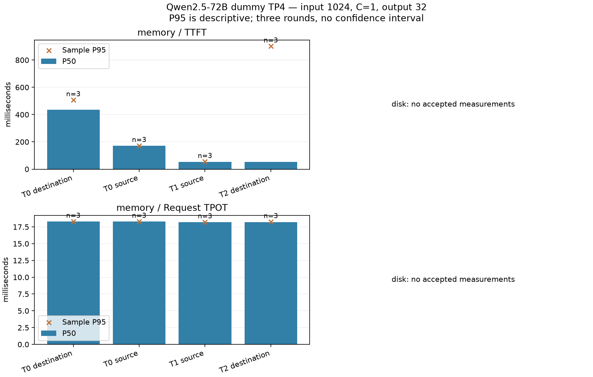

# MAC-16 五档 KV 验证报告

**已完成1024/C1的T0/T1/T2校准，T3/T4仍未测得，五档目标未完成。** 本机DRAM使TTFT均值从170.2降至53.0ms（3.21倍），decode TPOT约18.2ms/token。远端首读出现995.5ms尖峰，不给稳定跨机收益结论。主阻塞是缺少可保持隔离的双机窗口来完成SSD校准及HIXL初始化复测：外部八卡训练两次触发门禁；第三次在门禁后出现，并伴随HIXL/AICPU初始化失败。未停止外部进程，因果关系尚未证明。

17/17模型请求成功，其中12个正式请求、5个预热或prime；全部真实输入1024、输出32。1/64MiB本机与远端DRAM native读回12/12逐字节及SHA256匹配。数据、失败、脚本与计数窗口均保留。

## 完整正式对照

每条件三轮、每轮一个请求。分位数采用线性插值，n=3的P95/P99仅描述样本，不能作为稳定尾延迟。TTFT从HTTP请求开始到首个真实token；空文本token由logprobs计数，token间隔来自单token SSE事件。吞吐为输出token数除完整batch时间，不含前后的诊断调用。

| 条件 | n | TTFT均值/P50/P95/P99（ms） | TPOT均值（ms/token） | 输出吞吐（tokens/s） | 相对同节点冷均值 | 异常 |
|---|---:|---|---:|---:|---:|---|
| T0 本机未命中 | 3 | 170.23 / 170.45 / 171.88 / 172.00 | 18.288 | 43.38 | 基线 | 无请求失败 |
| T1 本机DRAM | 3 | 53.04 / 53.12 / 54.58 / 54.71 | 18.193 | 51.82 | −68.84% | 无请求失败 |
| T0 远端实例未命中 | 3 | 369.23 / 436.09 / 507.16 / 513.47 | 18.292 | 34.16 | 基线 | 三轮515.05 / 156.55 / 436.09ms，波动未定位 |
| T2 远端DRAM | 3 | 367.18 / 53.72 / 901.34 / 976.69 | 18.213 | 34.33 | −0.56% | 三轮995.52 / 52.30 / 53.72ms，首读尖峰保留 |
| T3 本机SSD | 0 | 未执行请求 | 未执行请求 | 未执行请求 | 无对照值 | r3门禁拒绝；r4服务HIXL初始化失败，无native SSD读回或模型请求 |
| T4 远端SSD | 0 | 未执行请求 | 未执行请求 | 未执行请求 | 无对照值 | 同上 |

没有删除异常或重试请求。远端首读四rank native get分别约7.93 / 290.21 / 290.96 / 952.02ms；最慢rank与995.52ms TTFT尖峰相符，后两轮各rank约6–7ms。原生调用可能重叠，不相加；连接初始化/传输等待是待验证解释。对应服务片段未见所检查的编译告警，不能简单归为JIT。新版加入实际模型worker的3轮local/remote加载预热，这一预热改动尚未NPU复测。

## 位置、真实工作量与传输量

| 档 | 读前证据 | 实际prefill重算 | native加载字节/请求 | 状态 |
|---|---|---:|---:|---|
| T0 | 新前缀、独占Master清理、NPU prefix reset；本机与外部命中计数为0，无native get | 1024 tokens | 0 | 两节点各三轮通过 |
| T1 | 所有实际加载key读前为COMPLETE MEMORY-only，owner在源物理节点；NPU命中0、外部1023 tokens | 1 token | 335,544,320 B（320MiB） | 三轮通过 |
| T2 | 同一源节点MEMORY-only，目标贡献DRAM为0；四rank真实get正返回，NPU命中0、外部1023 tokens | 1 token | 335,544,320 B | 三轮通过 |
| T3/T4 | 设计有lease等待、memory clear、disk-only审计与盘读门禁；本轮没有SSD读前实证 | 未测 | 未测 | 不计为通过 |

重算量来自`vllm:request_prefill_kv_computed_tokens_sum`阶段差分；使用同节点`prefix_cache_hits_total`验证HBM未命中。四rank各80MiB正返回，符合8个128-token块及BF16布局；320MiB物理搬运包含块对齐，不应按1023 tokens简单换算。Host DRAM流量、UB链路物理字节和SSD读字节尚未测得。

## 环境、容量与测量边界

基线1b05f19，SDK导入修正保持。两台物理Ascend950DT，卡0–3，每卡98304MiB；驱动26.2.0.b020、CANN/NNAL9.1.0、torch2.10.0、torch_npu2.10.0.post4、vLLM0.23.0+nds1.empty、vLLM-Ascend0.23.0+nds1、Mooncake NPU0.3.11.post1。完整Qwen配置及镜像指纹见使能手册。TP4、PD-colocated、BF16、dummy、graph、max_model_len25600、batched_tokens4096、max_num_seqs32；本轮只证明1024请求成功。

运行时报告KV容量627,328 tokens（一个TP4实例，不乘四）；逻辑实例KV空间约191.47GiB，理想每rank约47.87GiB。rank0服务日志记录权重33.8819 GB，四rank torch allocated/reserved约82.13/82.52GiB；权重未逐rank拆分实测，日志的GB标签保留，不能混同物理HBM使用量。原始逐卡npu-smi与完整metrics在证据包中。8K/16K/24K和C8/C25、实际OOM/容量拐点均未验证，配置长度不作为请求成功证据。

源DRAM池4×100GiB，目标贡献0；活跃并发1，单轮一个1024前缀，不是累积历史前缀压力实验。每次读前重置HBM，内存模式禁SSD。计数窗口约4.3–5.3秒，包括请求后的1秒异步保存等待及诊断开销；不能与请求时延相混淆。客户端/每rank单调时钟只作同域差值，两机wall time不直接相减。

## 已验证边界

两台历史A5的卡0–3精确矩阵计算与TP4 HCCL通过。每rank20次16KiB all_reduce均值为72.46–73.75µs；门禁没有逐次时延样本，不能据此评价模型延迟或尾部。模型配置与修正镜像两端一致。

初次正式任务在模型启动前被资源门禁拒绝。18:18资源释放后，完成三个内存档位。切换SSD时旧端口检查报Address in use；已改SO_REUSEADDR，并以活跃listener/服务器主动关闭后重启两项CPU测试验证。r3 SSD-only在启动前再次被其他训练占用拦住。

19:33资源释放后，重新预约并部署r4，source服务进入初始化。19:40:47的日志记录AdxlEngine status507018、HixlSyncTransferContext的AICPU retCode0x2a和TransferEngine ret−1；此时两端又出现外部八卡python进程，source与自有worker共用卡。不能仅凭同时出现就归因为共享负载，也不能把服务启动失败称为SSD读失败。未进入native SSD读回/模型预热或请求；只停止自有source容器，destination受控关闭。84个任务均确认终态/archiveReady（含8个非零退出），短诊断与清理同样已终态；两端自有容器、端口和offload目录消失，自己的预约释放。

新版在实际Node.start时再次执行占用门禁，并对已观测的TransferEngine致命初始化错误提前停止本进程自有容器，避免等满30分钟。这两项改动仅通过语法/CPU检查，尚未设备复测；必须重新部署新版指纹。r4失败日志与部署指纹保留，不能覆盖它。

19:47快照为55 ready、44个具备四卡空闲候选；这不代表能保持隔离，不能写成“全群无空闲机器”。下一步先在连续空闲观测窗口内用小规模native TE/SSD功能对照区分初始化问题，再开模型。

两端容器内CANN9.1.0的libascendcl.so/libacl_rt.so和宿主绑定libascend_hal.so均未导出aclrtMemP2PMapHost、aclrtMemP2PUnmapHost、aclrtRegisterP2P。本轮范围仅这些动态符号，不构成“A5不存在任何直通路径”的证明。MAC-11当前没有已完成的direct功能结果。

每台可见48个DDRC PMU，存在flux_rd/flux_wr；事件单位、通道覆盖与背景尚未校准，Host DRAM流量未测得。不能把盘或网络字节当成Host流量。

## 假设与矩阵

H1：外部加载可避开prefill重算；由同输入/并发/输出的T0与T1/T2对照判定。H2：SSD-only恢复可被位置、native返回字节及实际盘读共同证明；任何DRAM残留/部分加载/无盘读均反驳该样本标签。H3：direct减少Host中转的关键路径；当前缺少可调用通路和Host流量校准，证据不足。

完整预注册在`benchmarks/kv_tier/MATRIX.md`。先1024/C1、32输出、三轮；五档校准通过后再做8K/16K/24K、C1/8/25，容量超预算的格子明确跳过。脚本及复现方式见`docs/MAC16-AI-ENABLEMENT.md`。

T0/T1位置与重算证据支持H1在本轮本机条件下成立；T2支持功能可用，但延迟稳定性证据不足。H2/H3未完成验证。SSD分段、Host流量、压力换出和业务精度无本轮结论。不得迁移为V4-Flash的容量或端到端收益。

## 交付与下一步

仓库保存脱敏的17请求原始记录、每阶段位置/metrics/native trace、native读回与汇总/CSV/图表。原始部署信息、两端完整日志、硬件门禁、所有失败与预约清理通过MAC-16附件交付。报告与手册是阶段交付，PR为draft，不标记五档全部通过。

预算截止2026-10-16 17:34:44（北京时间）。下一项是取得覆盖启动与三轮SSD读的双机窗口，核对最新脚本指纹，设置`NDS_MODES_JSON='["disk"]'`续跑；通过后再预热模型worker传输并做长度/并发与压力消融。资源不足不重复启动、不清理外部训练，使用持久唤醒复查。12项CPU验证通过；新版预热和SSD端到端仍需设备实测。

## KV预算与收益边界

从实际配置推导的逻辑KV密度为`2(K,V)×80层×8 KV heads×128 dim×2B = 327680 B/token`，TP4理想分片为81920B/token/rank。它是布局推导，不能替代运行时物理分配/传输字节。1024/8192/16384/24576输入分别对应0.3125/2.5/5/7.5GiB逻辑KV；并发25的24K输入为187.5GiB，尚未加输出、padding及workspace，也未证明该组合可承载。

若direct仅移除Host中转、其余阶段不变，设staged恢复耗时T、真正落在关键路径的可移除时间h，则`ΔT≤h`、`speedup≤T/(T−h)`。重叠时h小于或等于独立copy时长；本轮没有h的实测值，不能填入假设的30–50%并称收益。历史MAC-14的7.48GB/s仅是单盘fio配置最好观测，不是本轮Mooncake恢复带宽。V4-Flash容量及端到端收益需另测。
