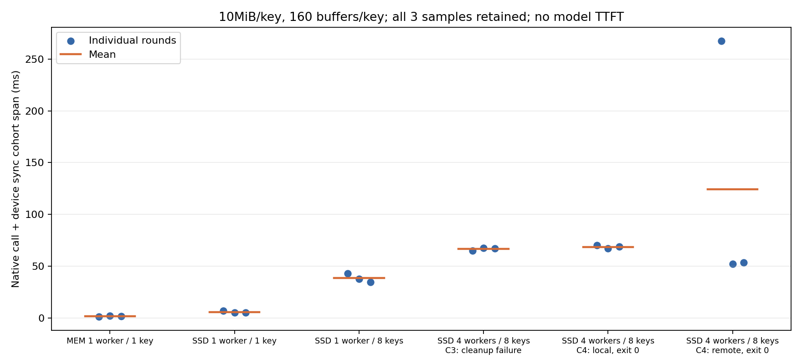

# B02 四 worker 原始 client 与多 buffer SSD 验证

**按模型布局构造的 native 本机/跨机 SSD 读回已经通过；模型 T3/T4 请求仍为 0，五档目标未完成。** B02-1/2 的四 worker、每 rank 8×10MiB、每 key 160 段 buffer，各完成三轮 SSD-only 读回；正常退出的 C4 共 192/192 个 key 逐字节、SHA256、长度一致。每轮源机物理盘读 335,675,392 B，即 320MiB payload + 32×4096B。B02-1/2/3 的 0–3 卡精确矩阵与 TP4 HCCL 均有本轮实际通过记录。

发现并修正了一个会阻止模型 SSD-only 门禁的问题：Master 要求 `BatchReplicaClear` 由原始写入 client 发起。知道正确 `store.get_hostname()` 仍不能授权 scheduler 或 rank0 代清其他 publisher 的 key。四 worker 分别清除自己发布的 key 后，32 个 key 全部达到 COMPLETE LOCAL_DISK-only；模型 override 新增原 worker 的 Unix 控制通道，native 中已验证相同控制模块，模型集成尚未设备验证。

模型预约前的资源复查两次未通过：B02-2、随后 B02-3 在候选快照后出现外部进程占用所选四卡。C5/C6/C7 仅准备了固定计划，未预约、未提交、没有模型启动。最后双机条件不足，issue 保持 blocked。唯一当前主阻塞是覆盖初始化、预热和三轮模型请求的双物理 B02 四卡窗口。没有停止外部任务或修改驱动、中台、磁盘结构。

## 环境和固定条件

固定镜像 `sha256:64155cd1bb77edf3c927a23c83cdad49e9d5394bd4b90113bc02ce017897c270`，驱动 26.2.0.b020；真实设备 Ascend950DT，0–3 卡 Warning 下实际矩阵/HCCL 通过。模型配置/tokenizer 与此前迁移相同，无真实权重下载。三台最新 20 文件 SHA 校验通过；更新的模型 toolkit 为 `9df66e4d0264230650a07eafc1f6c9d153fa347bd3446287aa591a061b9092e5`，旧 `56cedb68...` 不再代表最新模型代码。单卡旧 probe `e5367b7d...` 未改。

probe 不运行模型：BF16 storage 的 uint8 视图，PCG64 seed 42+rank；布局 `[80,2,K,128,2,128]`。每 key 收集 80 层 K/V 共 160 个分离的 64KiB buffer；K8 总 arena 80MiB/rank，整体 2MiB 对齐并注册。直接调用 `batch_put_from_multi_buffers` / `batch_get_into_multi_buffers`，参考字节依 layer/KV/block 索引独立比较，检测块次序错误。仅验证 opaque 字节布局，不代表模型数值精度。

writer 的 global segment 512MiB/client、local buffer 1GiB，reader 贡献 0、local buffer 1GiB；模型计划仍为每 rank 100GiB DRAM pool。native pool 大小和完整 72B 初始化不能互相替代。每 source rank 使用自己的 offload 目录，K1 seal、heartbeat1s、uring 关闭。磁盘位置门禁为全 key COMPLETE LOCAL_DISK → 不再查询等待6秒 lease → 原 publisher 清 MEMORY → 重审计 disk-only → NPU arena 清零 → 只对自有 bucket fsync/fadvise。无全局 pagecache 操作。

## 全部读回数据

下列时间是读入端四 rank 同一主机单调时钟的 `max(end)-min(begin)`，每次 native 调用后同步设备；排除了随后 CPU 复制/SHA 的时间。它不是纯盘时延或 TTFT。counter 窗口还包含协调、CPU校验等开销，不能与 native 时间相混。

| 配置 | cohort / native调用 / key读回 | 三轮 native 区间（ms） | 均值（ms） | 每轮源盘读（B） | 结果/异常 |
|---|---:|---|---:|---:|---|
| C2 MEMORY，1 worker×1 key | 3 / 3 / 3 | 1.574 / 2.094 / 2.033 | 1.900 | 0 | 数据通过；同任务后续四worker清除失败 |
| C2 SSD，1 worker×1 key | 3 / 3 / 3 | 6.926 / 5.472 / 5.429 | 5.942 | 10,489,856 | 数据/位置/盘读通过；相同10MiB MEMORY基线延迟 +212.69% |
| C2 SSD，1 worker×8 keys | 3 / 3 / 24 | 43.170 / 38.027 / 34.720 | 38.639 | 83,918,848 | 数据/位置/盘读通过；工作量不同，未套单key相对比 |
| C3 SSD，本机4 workers×8 keys | 3 / 12 / 96 | 65.237 / 67.745 / 67.400 | 66.794 | 335,675,392 | 数据通过；rank2清理等待超时，被父进程定点终止，task exit1 |
| C4 SSD，本机4 workers×8 keys | 3 / 12 / 96 | 70.171 / 67.074 / 68.904 | 68.716 | 335,675,392 | 数据/位置/盘读/Unix控制/全部退出通过 |
| C4 SSD，跨机4 workers×8 keys | 3 / 12 / 96 | **267.423** / 52.336 / 53.678 | 124.479 | 335,675,392 | 全部门禁通过；首读尖峰完整保留；对同量本机均值 +81.15%，不是稳定收益结论 |

合计 18 cohort、45 个 native batch 调用、318 个 key 完成读回全部数据一致，其中 MEMORY 3、SSD 315。C3 的失败生命周期不计为完整实验成功；C2 前置成功样本与后续失败均保存。RPC 是 batch 计数：SSD 每 rank 每轮 +1，不能说成每 key +1。



逐 rank 数据在 `native-layout-samples.csv`，窗口在四 rank 行重复，禁止将磁盘字节重复相加。源 host counter 含共享背景；与 own file eviction、disk-only、RPC、逐字节校验一起构成该实验的物理读证据，不代表 Host DRAM 或 UB 链路流量。跨节点 monotonic 不对齐，仅在读入节点内部计算重叠；不相加四 rank 延迟。n=3 只描述样本，无法给稳定尾部或普遍上下界。远端首读原因仍未定位。

## 失败、反证与修正

- **C1**：新增 wrapper 的 `set -u` 与厂商 ATB 脚本的未定义 `ZSH_VERSION` 冲突，进入计算前退出。容器内恢复原验证过的 `set -e`，外层参数仍严格检查；原代码按 SHA 重建保留。
- **C2**：四个 client setup/put 成功，32 key 持久化成功，但 rank0 调用清其他 publisher 的 key 被 Master 明确拒绝，日志含 `belongs to different client_id ... expected ... skipping`。只清除自己的8个；本次没有进入四worker SSD读。client身份假设被日志与后续原publisher对照支持；不是 SSD 数据读失败，也不是 TE 初始化失败。hostname/TE endpoint 的既有区分仍必需。
- **C3**：唯一语义修正为让每个原client清其own key，96个 key 正确读回，证明四worker位置门禁可满足。随后一名worker在旧20秒等待内未退出，父进程只终止该自有worker；真实 exit−15 保留。没有将数据通过改写成整轮 exit0。
- **C4**：验证模型集成所需的原client Unix控制通道；等待采用统一120秒上限，并记录 unregister/store-close 阶段。本机及跨机全部worker exit0；这不证明 SDK 偶发关闭问题普遍消失，也不能由这两个同时变化的因素单独推断关闭超时根因。
- C2 配置诊断的 enum 序列化出现递归展开大文件，已改为 enum 字符串，原记录仍保留。该前置开销未计入 native read 计时。
- 64MiB 单对象 SSD abort 为旧 W1 异常，本轮未重复。80MiB 分散于8个10MiB key 的成功以及 local buffer 增至1GiB，不能证明旧64MiB失败修复或精确最大对象边界。

B07 r4 的 HIXL/AICPU 507018/ret0x2a 历史仍保留；此轮 native 四worker成功不构成完整模型故障已修复的证据。

## 模型修改和未执行项

`worker_control.py` 只用原有 store 对象记录成功 put 的 own key，通过 task-owned、0600 Unix socket 执行元数据清除，不创建新client、不执行远端命令。scheduler 只协调审计；微基准由原agent client清除自己的probe key，模型key由原worker清除，覆盖不完整则拒绝标签。`store_ready` 记录 original hostname/pid/socket，排除零贡献 scheduler。

CPU 原始 client 权限对照、缺worker控制映射拒绝及布局覆盖等共21测试通过；对实际部署 backend 应用 override 后 AST/语法通过。模型预热改为真实 worker 的 SSD-only T3/T4 加载，预热样本与正式统计分开保留。四worker控制模块已 native NPU 验证，完整模型 override、实际模型预热、fatal-TE 收尾仍未模型 NPU 验证。调用侧核对显示 worker 默认contribute_memory=True，global pool0仍保留配置local1GiB；false/local0是scheduler行为，探索过的buffer参数改动已撤回，未部署。

T3/T4 模型样本0；真实32输出、8K/16K/24K、C8/C25、HBM/DRAM压力及 Host DDRC 流量均尚未测量。未发现可调用 SSD→HBM direct 本轮通路，不开发内核、不把 O_DIRECT 或 SDK buffer注册称为 SSD direct。若可移除关键路径Host中转为h、staged时长T，则收益仅有符号上限 `speedup≤T/(T−h)`；h没有实测值。

## 复现和恢复

私有增量附件提供完整 task archive、各版本 helper/指纹、预约/释放及新模型 toolkit。解压四个 `layout-c*.tar.gz` 到相应 `layout-c*/`，将终态 JSON 放同级后：

```bash
python3 benchmarks/analyze_sdk_layout.py --raw-root RAW --out REPORT
# 图需要 matplotlib；本轮生成图用 Python3.11 + matplotlib3.10.7。
```

模型 continuation 用 fixed atomic group controller：先需要两个不同更新时间的真实所选四卡空闲快照，再 reserve，启动重新检查。1/2 native 跨机已验证；1/3 只有计算/HCCL及资产，若切换到3先完成该对四worker SSD校验。`sdk_layout_group.py --resume-four-worker --compute-peer-only --cross-only` 与 `model_group.py --destination ... --kit ...` 可以在一个固定预约/任务内依序运行。不得复用 released预约或旧task ID；未知回执只查原ID。新task必须本顶层turn等待所有原PID终态并收集 archiveReady 后才释放。

本轮自己的5个中台task全部终态/archiveReady：route exit0，C1/C2/C3 exit1，C4 exit0；累计138个。所有自有容器、native端口/offload及预约已清；镜像、配置和准备代码保留。C5/C6/C7计划无执行回执，不能当成启动过的模型task。原20个历史短诊断与本轮前台SSH文件/只读操作分开记录。资源规则按新指纹/已证边界继续至 `2026-10-16T09:34:44Z`；最后60分钟不开90分钟模型任务。截止不完整按退出条件交缺口，不标五档通过。
