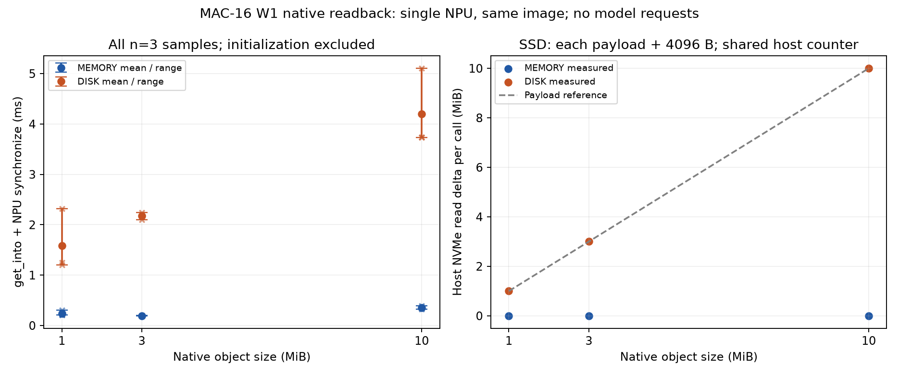

# MAC-16 W1：原生 SSD-only 对照

**单卡 native 的 1/3/10MiB SSD-only 均通过三轮完整读回；模型 T3/T4 仍为零请求，五档目标未完成。** 每次读取前为 COMPLETE LOCAL_DISK-only，租约等待6秒，NPU目标清零；逐字节、SHA256及返回长度一致。只对本任务的 bucket 文件 fsync/fadvise 后，每轮主机 NVMe 读计数为载荷加4096B，reader offload RPC计数加1。

当前模型每rank每个128-token KV键实测10MiB，本轮同大小的单对象读回通过，不能宣称模型的8键batch或四rank路径已通过。64MiB单对象在部署库 FileStorage::AllocateBatch 的 kMaxSliceSize 断言处退出；未产生有效SSD性能样本。主阻塞仍是具备相同模型资产、可同时预约并持续四卡空闲的双物理A5窗口。

## 假设与实验矩阵

| 假设 | 基线与改变因素 | 固定条件 | 判据与结果 |
|---|---|---|---|
| 原r4初始化错误代表所有A5 native HIXL不可用 | 换到授权候选节点，先TP4门禁，再单卡MEMORY/SSD setup | 相同镜像SHA、SDK及导入顺序 | 两mode均setup=0；反驳普遍不可用，不能确定原B07的失败原因 |
| 小样本可在原32 keys配置下立即落盘 | K32→K1，其余配置相同 | 1MiB对象、私有Master、heartbeat1s | K32等待120s无LOCAL_DISK；K1生成LOCAL_DISK。支持seal策略解释，但未穷举seal的其他触发条件 |
| memory descriptor的TE endpoint可用于清除MEMORY | 先尝试TE endpoint，再改为唯一贡献client的store.get_hostname() | 同节点、K1、对象及租约 | TE endpoint未清除；SDK控制hostname成功。不能混用两种端口 |
| disk-only标签足以证明物理盘读 | 先保留OS缓存，再仅对自己的bucket执行fsync+POSIX_FADV_DONTNEED | 1MiB、同SDK、lease6s、逐字节校验 | 缓存三轮盘读0；冷文件三轮均载荷+4096B。标签与offload RPC不足以单独证明盘读 |
| 当前业务10MiB对象可能超出SSD恢复大小限制 | 1/3MiB校准后只增至10MiB；保留此前64MiB失败 | 同节点/镜像/池/K1/布局，3轮，先MEMORY再SSD | 10MiB三轮通过；64MiB断言。反驳基于参考源码推断的10MiB超限，不推定准确最大值 |

## 环境与执行范围

2026-10-13，本轮授权替代节点 a5-b02-1；真实数据IP、SSH映射与部署命令在私有附件内，仓内脱敏为SOURCE。950DT八卡均Warning；0–3实际整数矩阵精确且TP4 HCCL正确，四rank20次16KiB all_reduce均值74.33–76.61µs。此值不是模型通信尾延迟；未停止其他训练。

镜像为`nds-vllm-source:kv-import-fix-20261012`，SHA256 `64155cd1bb77edf3c927a23c83cdad49e9d5394bd4b90113bc02ce017897c270`。Mooncake NPU0.3.11.post1、torch2.10.0、torch_npu2.10.0.post4、CANN/NNAL9.1.0、driver26.2.0.b020，与历史配置一致。既定Qwen config/tokenizer目录在该节点不存在；只核查该路径，没有下载真实weights，也没有启动模型。

数据目录位于`/dev/nvme0n1p4`的ext4根盘，约3.31TB可用；其他三块NVMe未挂载，不算四盘聚合。单卡probe的private Master端口50316/50317，MEMORY贡献256MiB、local buffer32MiB；SSD配额512MiB、staging128MiB、bucket256MiB、keys=1、heartbeat1s、uring=false。宿主CPU/盘计数属于共享资源，预约不等于物理独占。

预注册见附件`native_w1_plan.md`和`boundary_w1_plan.md`。每个远端任务限时300/360秒并前台收集到终态/archiveReady；SDK导入在torch选择设备之后。值为numpy PCG64 seed=42+对象字节数生成的uint8位置敏感数组，2MiB地址对齐，读取前NPU清零并同步。get_into计时包含调用及随后NPU同步，排除初始化、租约等待、cache eviction和CPU验证；仅同进程单调时钟差值。

## 完整正式对照

下表使用冷文件1/3MiB运行与独立10MiB边界运行的全部样本，n=3。两个运行的设备、镜像、配置及方法相同，10MiB重新初始化SDK；规模差异不能直接归因为纯IO带宽。

| 对象/副本 | n | 全部调用时长ms | 均值/中位数ms | 相对同大小MEMORY均值 | 每轮盘读B / RPC | 异常 |
|---|---:|---|---|---:|---|---|
| 1MiB MEMORY | 3 | 0.30510 / 0.21397 / 0.20732 | 0.24213 / 0.21397 | 基线 | 0 / 0 | 首读较慢，保留 |
| 1MiB LOCAL_DISK-only，冷文件 | 3 | 2.31720 / 1.24712 / 1.20158 | 1.58863 / 1.24712 | +556.11% | 1,052,672 / 1 | 首读较慢，保留 |
| 3MiB MEMORY | 3 | 0.19405 / 0.19279 / 0.19696 | 0.19460 / 0.19405 | 基线 | 0 / 0 | 无读回失败 |
| 3MiB LOCAL_DISK-only，冷文件 | 3 | 2.24087 / 2.16935 / 2.10414 | 2.17145 / 2.16935 | +1015.85% | 3,149,824 / 1 | 无读回失败 |
| 10MiB MEMORY | 3 | 0.39549 / 0.34226 / 0.32418 | 0.35398 / 0.34226 | 基线 | 0 / 0 | 独立边界运行 |
| 10MiB LOCAL_DISK-only，冷文件 | 3 | 5.10677 / 3.73558 / 3.74592 | 4.19609 / 3.74592 | +1085.41% | 10,489,856 / 1 | 首读较慢，保留 |
| 1MiB LOCAL_DISK-only，OS缓存保留 | 3 | 1.59082 / 0.79166 / 0.63286 | 1.00511 / 0.79166 | 未与正式MEMORY配对 | 0 / 1 | 读回正确，**不算物理SSD性能** |
| 64MiB LOCAL_DISK-only | 0有效SSD样本 | get_into中abort，exit134 | 无有效统计 | 无 | 无完成调用记录 | MEMORY同大小三轮通过；SSD断言失败完整保留 |

图中点均为实测，误差棒为样本min/max；虚线仅为载荷大小参考。1/3MiB与10MiB正式对照共18次完整读回，其中9次SSD具有物理盘读证据。图不包括缓存SSD三轮，原始记录另列；没有删除首读。全部探索运行中的成功MEMORY样本和失败保留在`data/all-native-records.csv`、`all-native-runs.json`及私有原始归档中，不能把多个探索运行拼接为更大的正式样本数。

## 失败、纠正与源码证据

初次inspect脚本遗漏换行导致cd参数错误，base64重试未修复这个生成错误；不是中台wrapper问题。第一次native shell的`set -u`与vendor ATB set_env中的ZSH_VERSION不兼容，SDK未执行；改回基线的`set -e`。K1试验先后暴露缺少get_local_disk_descriptor API及缺少segment_name字段，均保留报错。10MiB首次命令含错误的`+`续行，Docker exit125且SDK未启动；修正后使用新task ID，才获得正式三轮数据。这些失败不算SDK功能或性能样本。

同tag上游[FileStorage AllocateBatch](https://github.com/kvcache-ai/Mooncake/blob/e9c61075720039bcfc5fffd19f847608402be3d0/mooncake-store/src/file_storage.cpp)有大小断言；部署库64MiB报错的文件和行号与之相符。上游types以CacheLib slab大小减16定义kMaxSliceSize，但部署库具体编译常量未直接读取。根据参考CacheLib推断的4MiB不能当成本镜像上限，**10MiB实际通过已推翻该推断**。仅支持已测大小，不断言3–10MiB之间所有布局都已测，也不声称准确最大对象值。

[RealClient reader路径](https://github.com/kvcache-ai/Mooncake/blob/e9c61075720039bcfc5fffd19f847608402be3d0/mooncake-store/src/real_client.cpp)在发起offload RPC时累加offload_rpc_read_count；并将每object的目标buffer长度求和。reader计数有解释作用，不能单靠它证明物理盘读或SSD→HBM direct。当前模型10MiB/key的单对象已经可读；四worker的多key batch、同机/跨机恢复仍须功能校验。

## 适用边界与下一步

主机NVMe读计数在每次get_into窗口读取，均出现payload+4096B；这与任务bucket读取相符。它包含共享主机负载，不能单独分配到某进程，也不是Host DRAM流量。只有位置、RPC、逐字节一致及盘计数共同支持本次native staged SSD读回。没有分段设备事件，无法将这些时长拆成盘/Host/H2D/同步，不能当成模型TTFT或普遍SSD带宽上界。

1MiB MEMORY比3MiB略慢，样本量与软件开销足以混淆容量趋势；不拟合硬件带宽上限。direct无可调用验证、Host PMU未校准，仍只保留符号收益约束`ΔT≤关键路径中可移除的Host中转时间`，不填虚构百分比。HIXL在本node初始化成功不能解释历史r4共享负载/节点环境/多worker错误的因果。

13:52Z释放自己预约后的快照有54 ready、13个四卡空闲候选，但均处于proxy共用预约入口；第二个proxy预约此前409，不能绕过。原B07两节点新鲜npu-smi均无空闲卡。ready与候选数不等于可同时预约的双机窗口。37个W1任务全部终态/archiveReady；累计121个task、20个短诊断终态。已核验自有容器、50316/50317及offload目录消失，两个W1预约均释放。

下一步在预算内先取得具备模型config/tokenizer、相同镜像的可同时预约双机窗口。先证明**10MiB×8键、四worker**同机及跨机的SSD native加载，再执行1024/C1模型T3/T4，保留32实际输出及至少三轮；不得从单卡probe直接宣称模型成功。校准完成后再做80%容量内长上下文/并发及分离HBM/DRAM压力。

## 复现与脚本状态

独立probe为`benchmarks/sdk_tier_probe.py memory|disk`，运行于上述镜像，必须使用自己私有Master和空offload目录。默认1/3MiB；10MiB专门边界运行设置`NDS_BOUNDARY_PROBE=1 NDS_PROBE_SIZES_JSON='[10485760]' NDS_OWN_FILE_COLD=1`。准确docker命令、机器映射和SDK指纹在附件helper中；不要复制或打印会话凭据。

仓内离线验证/绘图：`uv run --with matplotlib python3 benchmarks/analyze_native_w1.py reports/mac16/w1/data`。该命令验证每个返回值/SHA、三轮数量及SSD-only/物理读证据后生成CSV/JSON/PNG，失败64MiB不会混入性能样本。`raw-index.json`将仓内脱敏JSON映射到附件原始member及两侧SHA。

模型helper已改为1key bucket校准、MEMORY 1/64MiB与SSD 1/3MiB安全探针；记录贡献worker的store.get_hostname，拒绝缺rank/错误节点，区分TE endpoint；仅自有bucket fadvise；引用位置敏感数据。15项CPU测试与语法检查通过。**这些组合改动尚未在四worker模型路径NPU验证**；实际worker预热、启动时复查及fatal-TE清理同样未有模型设备复测。下一run须重新部署最新指纹，不能重用旧65d89b6版本。
